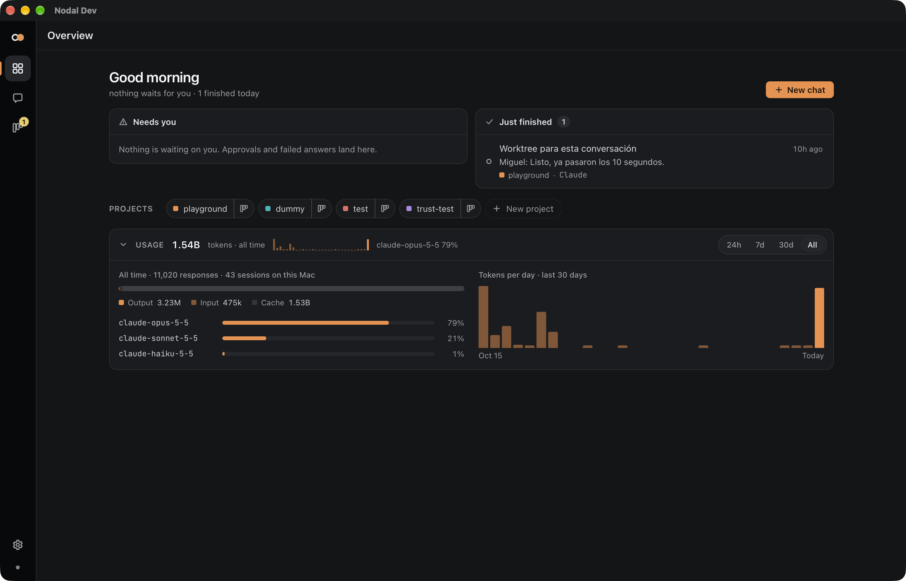

# Nodal

[](https://github.com/Mazp17/nodal-agentos/actions/workflows/ci.yml)
[](https://github.com/Mazp17/nodal-agentos/releases)
[](#instalación)
[](LICENSE.md)

**Un espacio de trabajo de escritorio para Claude Code.** Chatea con Claude en todos tus proyectos, responde lo que necesita desde una sola bandeja y convierte conversaciones en tareas que corren en su propio worktree.

[English](README.md)



> macOS y Windows. Proyecto independiente, sin relación con Anthropic.

## Instalación

### macOS

1. Descarga el último `.dmg` desde [Releases](https://github.com/Mazp17/nodal-agentos/releases) (Apple Silicon e Intel) y arrastra Nodal a Aplicaciones.
2. Nodal no está notarizado por Apple, así que macOS bloquea la primera apertura. Corre una vez:

   ```bash
   xattr -dr com.apple.quarantine /Applications/Nodal.app
   ```

### Windows

1. Descarga el último `Nodal_x.y.z_x64-setup.exe` desde [Releases](https://github.com/Mazp17/nodal-agentos/releases) (Windows 10/11 x64) y ejecútalo.
2. El instalador no está firmado, así que SmartScreen muestra "Windows protegió su PC". Haz clic en Más información → Ejecutar de todas formas.

Después, Nodal se actualiza solo: busca una versión nueva al abrirse y una vez al día (y desde Nodal → Check for Updates… o Settings → Updates), muestra las notas de la versión y la instala solo si eliges Update. Las actualizaciones no necesitan repetir el `xattr` ni el paso de SmartScreen. Nodal 0.1.0 es anterior a las actualizaciones in-app, así que desde 0.1.0 descarga la versión siguiente a mano por última vez.

Necesitas [Claude Code](https://docs.claude.com/en/docs/claude-code) instalado y con sesión iniciada, y `git`. `gh` es opcional, para tareas que abren pull requests. Abre `claude` una vez en cada repo y acepta el diálogo de confianza antes de correr tareas ahí.

## Qué hace

- **Chats por proyecto**: habla con Claude sobre un proyecto entero o un repo, con tu propio agente (`~/.claude/agents`, los del repo o de un plugin), modelo y esfuerzo. Las llamadas a herramientas, los diffs y los subagentes se ven en vivo. Las sesiones aparecen en `claude --resume`.
- **Bandeja en el Overview**: aprobaciones y chats fallidos que esperan por ti, lo que acaba de terminar, tus proyectos y un resumen de los tokens que Claude Code usó en esta máquina.
- **Tareas como chats**: planifica tareas en un board (planes en markdown, criterios de aceptación, prioridad, etiquetas). Abrir una tarea inicia un chat en su propio worktree y rama de git, así varias corren a la vez en el mismo repo; su estado sigue al chat.
- **Git en la app**: panel de archivos y editor, commit de todo o de archivos elegidos, diff contra la base de la rama, y pull requests con `gh` o pidiéndoselo al chat.
- **Linear, opcional**: importa issues, las rutea a repos y mantiene los estados sincronizados.

## Cómo funciona

Nodal maneja el CLI `claude` que ya tienes, en modo stream-json de `claude -p`, y lee el historial y el uso de tokens de los archivos de sesión en `~/.claude/projects`. Partes de ese protocolo y de esos archivos no están documentadas, así que una actualización de Claude Code puede romperlas.

Todo queda en tu Mac: una base SQLite, los worktrees en `~/.nodal` y las API keys en el Llavero. Sin servidor ni telemetría.

## Compilar desde el código

Necesitas Node.js 20+, pnpm 10 y Rust estable.

```bash
git clone https://github.com/Mazp17/nodal-agentos.git nodal
cd nodal
pnpm install
pnpm tauri dev
```

Hecho con [Tauri 2](https://tauri.app) (Rust + SQLite) y React 19 + TypeScript. En [CONTRIBUTING.md](CONTRIBUTING.md) está cómo trabajar en el proyecto y en [RELEASING.md](RELEASING.md) cómo se publican las versiones.

## Licencia

[MIT](LICENSE.md) © Nodal contributors
